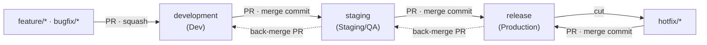

# Branching Strategy

How code moves from a developer's machine to production for **wealthlens-fe**.
The GitHub settings that enforce these rules are in [BRANCH_PROTECTION.md](./BRANCH_PROTECTION.md).

## TL;DR

- Work on a short-lived `feature/*` or `bugfix/*` branch cut from `development`, open a PR, **squash merge**.
- Promote `development` → `staging` → `release` with PRs that use a **merge commit** (never squash).
- Production fixes go on a `hotfix/*` branch cut from `release`, then get back-merged `release` → `staging` → `development`.
- Nobody pushes directly to `development`, `staging` or `release`. Everything goes through a PR with green CI.

## Long-lived branches

Each long-lived branch maps to exactly one environment.

| Branch        | Environment | Purpose                                              | Accepts PRs from                              |
|---------------|-------------|------------------------------------------------------|-----------------------------------------------|
| `development` | Dev         | **Default branch.** Integration of all feature work. | `feature/*`, `bugfix/*`, `staging` (back-merge), `backmerge/*` |
| `staging`     | Staging/QA  | Pre-production testing.                              | `development` (promotion), `release` (back-merge), `backmerge/*` |
| `release`     | Production  | Production code only.                                | `staging` (promotion), `hotfix/*`             |

The "accepts PRs from" column is enforced by the `branch-policy` CI check (`.github/workflows/ci.yml`).

## Short-lived branches

| Prefix       | Cut from      | PR into       | Merge method | Example                                   |
|--------------|---------------|---------------|--------------|-------------------------------------------|
| `feature/`   | `development` | `development` | Squash       | `feature/PROJ-123-portfolio-summary`      |
| `bugfix/`    | `development` | `development` | Squash       | `bugfix/PROJ-140-chart-tooltip-overflow`  |
| `hotfix/`    | `release`     | `release`     | Merge commit | `hotfix/PROJ-151-login-redirect-loop`     |
| `backmerge/` | target branch | target branch | Merge commit | `backmerge/hotfix-proj-151` (only when a back-merge conflicts) |

Naming: `<type>/<TICKET>-<short-kebab-description>`. The ticket key is uppercase letters/digits, a dash and a number (`PROJ-123`); the description is lowercase words joined by dashes. CI rejects branches that do not match.

Delete branches after they are merged (enabled automatically, see [BRANCH_PROTECTION.md](./BRANCH_PROTECTION.md)).

## Flow diagram

```mermaid
%%{init: { 'gitGraph': { 'mainBranchName': 'development' } } }%%
gitGraph
    commit id: "initial"
    branch staging
    branch release
    checkout development
    branch feature/PROJ-101
    commit id: "add portfolio card"
    checkout development
    merge feature/PROJ-101 id: "squash #101"
    branch bugfix/PROJ-102
    commit id: "fix tooltip overflow"
    checkout development
    merge bugfix/PROJ-102 id: "squash #102"
    checkout staging
    merge development id: "promote to staging"
    checkout release
    merge staging id: "promote to release"
    branch hotfix/PROJ-150
    commit id: "fix login redirect"
    checkout release
    merge hotfix/PROJ-150 id: "hotfix #150"
    checkout staging
    merge release id: "back-merge release"
    checkout development
    merge staging id: "back-merge staging"
```

The same flow as an overview:



## Workflows

### 1. Feature or bugfix

```bash
git switch development
git pull
git switch -c feature/PROJ-123-short-desc
# ...work and commit as often as you like...
git push -u origin feature/PROJ-123-short-desc
```

1. Open a PR into `development`. Give it a clear title; with squash merge the PR title becomes the single commit on `development`.
2. Wait for CI (`build-and-test`, `branch-policy`) to go green and get an approval.
3. **Squash and merge.**

To pick up newer changes from `development`, either rebase or merge it into your branch; both are fine because the branch is squashed at the end.

### 2. Promote `development` → `staging`

1. Open a PR with base `staging` and head `development` (e.g. *"Promote development to staging"*).
2. CI green, approval from QA/lead.
3. **Create a merge commit** (not squash). This keeps `staging` sharing history with `development`, so the next promotion only contains new commits and does not conflict with the previous one.
4. Deploy `staging` to the Staging/QA environment.

### 3. Promote `staging` → `release` (production release)

1. Open a PR with base `release` and head `staging`.
2. CI green, approval from the release owner.
3. **Create a merge commit.**
4. Deploy `release` to Production.

There is no back-merge needed after a normal promotion: `release` now contains exactly what `staging` and `development` already have.

### 4. Hotfix

```bash
git switch release
git pull
git switch -c hotfix/PROJ-151-short-desc
# ...fix and commit...
git push -u origin hotfix/PROJ-151-short-desc
```

1. PR into `release`, CI green, approval.
2. **Create a merge commit.**
3. Deploy `release` to Production.
4. **Back-merge** `release` → `staging` → `development` (next section). Do this straight away so the fix is not lost in the next promotion.

### 5. Back-merge (after a hotfix)

1. Open a PR with base `staging`, head `release`. **Merge commit.**
2. Open a PR with base `development`, head `staging`. **Merge commit.**

If a back-merge has conflicts (e.g. `development` has changed the same code), they cannot be resolved on the protected branch. Use a `backmerge/*` branch instead:

```bash
git switch development
git pull
git switch -c backmerge/hotfix-proj-151
git merge origin/staging      # resolve the conflicts here and commit
git push -u origin backmerge/hotfix-proj-151
```

Open the PR from `backmerge/hotfix-proj-151` into `development` and **merge with a merge commit**. Do not squash it: squashing throws away the link to `staging`, and the same conflict comes back on the next promotion.

## Merge method summary

| Into          | From                            | Method           | Why                                                        |
|---------------|---------------------------------|------------------|------------------------------------------------------------|
| `development` | `feature/*`, `bugfix/*`         | **Squash**       | One commit per change; clean, readable history.            |
| `development` | `staging`, `backmerge/*`        | **Merge commit** | Back-merges must keep the shared history.                  |
| `staging`     | `development`, `release`, `backmerge/*` | **Merge commit** | Keep branch histories aligned; avoid repeated conflicts. |
| `release`     | `staging`, `hotfix/*`           | **Merge commit** | Same reason.                                               |

`development` has to allow both squash (features) and merge commits (back-merges), so both buttons are enabled there. The reviewer merging the PR is responsible for choosing **squash** for feature/bugfix PRs. `staging` and `release` only allow merge commits.

## Release cadence

The cadence (per sprint or monthly) is not fixed yet. Nothing in this flow depends on it: a release is just *"promote `staging` → `release`"* and can happen whenever the team decides. Hotfixes can ship at any time in between.

## Initial setup (one-off)

The repository currently uses `master`. To switch over:

1. Create the three branches from the current `master`:
   ```bash
   git switch master
   git pull
   git push origin master:development
   git push origin master:staging
   git push origin master:release
   ```
2. Make `development` the default branch: *Settings → General → Default branch*.
3. Apply the settings in [BRANCH_PROTECTION.md](./BRANCH_PROTECTION.md).
4. Retarget any open PRs from `master` to `development`, then delete `master` and stale branches (e.g. `Home-page`).
