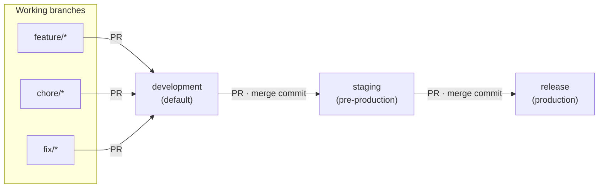

# Branching Strategy, Hooks & Migration Runbook

Single reference for the WealthLens (`wealthlens-fe`) branch environments, promotion policy, local git hooks, manual GitHub/Sonar/GHCR configuration, and rollback steps.

---

## 1. Branch environments & promotion flow



| Branch | Purpose | Allowed PR head | Merge method | Direct push? |
|---|---|---|---|---|
| `feature/*`, `chore/*`, `fix/*` | Short-lived working branches (branched from `development`) | — | — | Yes |
| `development` | Integration & default branch | `feature/*`, `chore/*`, `fix/*` | Squash or merge commit | ❌ PR only |
| `staging` | Pre-production verification | `development` (same repo) | **Merge commit only** | ❌ PR only |
| `release` | Production | `staging` (same repo) | **Merge commit only** | ❌ PR only |

- **Branch naming pattern:** `^(feature|chore|fix)/[A-Za-z0-9][A-Za-z0-9._-]*$` (e.g. `feature/WL-42-holdings-table`, `chore/git-safety`, `fix/WL-55-login-redirect`).
- **No direct `hotfix/*` → `release`:** all fixes follow `fix/* → development → staging → release`.
- **Promotion enforcement:** `.github/workflows/pr-policy.yml` (required check **`Promotion policy`**) automatically rejects invalid promotion paths and cross-repo promotions into `staging`/`release`.

---

## 2. CI gates & Docker tags per environment

| Branch | Required PR checks | Docker `BUILD_CONFIG` | Output hashing | GHCR tags pushed (`ghcr.io/this-is-thiru/wealthlens-fe`) |
|---|---|---|---|---|
| `development` | `Test, coverage & SonarQube`, `Docker image`, `Promotion policy` | `development` | none | `development`, `development-<short-sha>` |
| `staging` | `Test, coverage & SonarQube`, `Docker image`, `Promotion policy` | `staging` | `all` | `staging`, `staging-<short-sha>` |
| `release` | `Test, coverage & SonarQube`, `Docker image`, `Promotion policy` | `production` | `all` | `release`, `release-<short-sha>`, **`latest`** |

- Pull requests build and smoke-test the Docker image but **never push** to GHCR.
- `latest` is updated on `release` pushes only.

### Local development & Docker policy (permanent)
- **No local Docker required:** Local development uses **Node.js, npm, Angular CLI, and Git only**. Do not require or install Docker Desktop / Docker Engine on developer laptops, and keep local verification independent of Docker.
- **Cloud-only Docker builds & checks:** All Docker image builds, `scripts/docker-smoke-test.sh` smoke tests, and GHCR publishes run exclusively on GitHub Actions cloud runners inside the mandatory `Docker image` job (failures block merge).
- **How to verify Docker & GHCR in GitHub Actions (without local Docker):**
  1. Open **Actions → CI/CD** and select the run for your PR or branch push.
  2. In the run's **Summary** tab, check **Docker image**: confirm `Build config` (`development` / `staging` / `production`), `Pushed` (`false` on PRs, `true` on pushes), and the exact tag list (`<branch>`, `<branch>-<short-sha>`, plus `latest` on `release` only).
  3. Open **Docker image → Smoke test image** logs and verify `Smoke test passed` (for `staging` and `release`, also confirm the immutable `Cache-Control` check passed for a fingerprinted asset rather than being skipped).
  4. For pushes, open **Packages → wealthlens-fe** in the repository sidebar to confirm the published tags and timestamps in GHCR.

---

## 3. Local git hooks (`.githooks/`)

Zero-dependency Node.js `.mjs` hooks compatible with Windows (PowerShell / Git Bash) and Linux/macOS.

### Setup (once per clone)
```bash
npm ci
npm run hooks:install
```
Verify: `git config --local --get core.hooksPath` outputs `.githooks`.
Remove (rollback): `npm run hooks:uninstall`.

### What each hook enforces

| Hook | Checks |
|---|---|
| `pre-commit` | 1. Blocks commits on `development`, `staging`, `release`, `master`<br>2. Blocks staged `.env` / `.env.*` (except `.env.example`), `*.pem`, `*.key`, `node_modules/`, `dist/`, `coverage/`<br>3. Runs ESLint on staged `src/**/*.{ts,html}` (respects `eslint-suppressions.json`)<br>4. Runs Prettier check on staged `ts/html/css/scss/js/mjs` (never auto-modifies files) |
| `commit-msg` | Enforces Conventional Commits: `<type>(<scope>): <summary>` (max 100 chars; types: `feat`, `fix`, `chore`, `docs`, `refactor`, `style`, `test`, `ci`, `build`; optional `[TICKET-ID]`). Allows `Merge`, `Revert`, `fixup!`, `squash!`. |
| `pre-push` | 1. Blocks pushes to or deletions of `development`, `staging`, `release`, `master`<br>2. Validates working branch name (`feature/*`, `chore/*`, `fix/*`)<br>3. Runs `npm run typecheck`<br>4. Runs `npm run test:ci` (Vitest + coverage thresholds; skipped for pure branch deletions) |

---

## 4. Branch migration runbook (retiring `master`)

`master` stays functional and untouched until all gates pass.

| Step | Owner | Action | Gate |
|---|---|---|---|
| M0 | Agent | Implement on `chore/git-safety` (created from `master`, temporary migration exception); push after approval. | — |
| M1 | Thiru | Open bootstrap PR `chore/git-safety → master` (`Promotion policy` allows `master` as transitional). Wait for CI green, merge. | **G1:** CI green on `master` |
| M2 | Thiru | In GitHub UI, create `development`, `staging`, and `release` from `master` (all at the same commit). | G1 passed |
| M3 | Thiru | Watch the first push CI run on each new branch: `Test, coverage & SonarQube` + `Docker image` green; verify GHCR tags (`development`, `staging` with hashed assets, `release` + `latest`). | **G2:** all 3 branches green + images tagged |
| M4 | Thiru | Configure SonarQube Cloud (§5.3), GHCR (§5.4), and GitHub Rulesets (§5.2). | **G3:** all 3 required check names visible in ruleset picker |
| M5 | Thiru | Dry-run positive promotion: trivial `chore/*` PR → `development`; `development` → `staging` (merge commit); `staging` → `release` (merge commit). | — |
| M6 | Thiru | Dry-run negative checks: open (do not merge) `feature/x → staging` and `development → release`; verify `Promotion policy` fails, then close PRs. | **G4:** M5 + M6 passed |
| M7 | Thiru | Switch GitHub default branch to `development`; add a read-only ruleset locking `master`; switch Sonar main branch to `development`. | G4 passed |
| M8 | Thiru | **Soak period:** ≥ 1 full successful promotion cycle **and** ≥ 7 days with no CI/promotion incident. Then merge a follow-up `chore/retire-master` PR (via `development → staging → release`) removing `master` from `.github/workflows/ci-cd.yml` and `pr-policy.yml`, and delete `master` in GitHub UI. | **G5:** soak passed before deleting `master` |

---

## 5. Manual configuration checklists (Thiru)

### 5.1 GitHub repository prerequisites
- [ ] **Settings → Actions → General → Workflow permissions:** *Read repository contents*.
- [ ] **Settings → Secrets and variables → Actions:** confirm `SONAR_TOKEN` is set.
- [ ] **Settings → General → Pull Requests:** allow **merge commits** and **squash merging**; enable **Automatically delete head branches** (protected branches are shielded by rulesets).
- [ ] Confirm the **SonarQube Cloud GitHub App** is installed on this repository for PR decoration.

### 5.2 GitHub branch rulesets (`Settings → Rules → Rulesets → New branch ruleset`)
Create three **Active** rulesets (0 required approvals while working solo; raise to 1 when a second reviewer joins; all status checks and protections remain mandatory):

| Setting | `development` | `staging` | `release` |
|---|---|---|---|
| Target | `refs/heads/development` | `refs/heads/staging` | `refs/heads/release` |
| Restrict deletions | ✅ | ✅ | ✅ |
| Block force pushes | ✅ | ✅ | ✅ |
| Restrict creations | — | ✅ | ✅ |
| Require a pull request before merging | ✅ | ✅ | ✅ |
| Required approvals | `0` (solo) | `0` (solo) | `0` (solo) |
| Dismiss stale approvals on push | ✅ | ✅ | ✅ |
| Require conversation resolution | ✅ | ✅ | ✅ |
| Require status checks to pass | `Test, coverage & SonarQube`, `Docker image`, `Promotion policy` | same | same |
| Require branches to be up to date | ✅ | ❌ (do not enable) | ❌ (do not enable) |
| Allowed merge methods | Squash or Merge commit | **Merge commit only** | **Merge commit only** |

> [!WARNING]
> Do **not** enable "Require branches to be up to date" or squash merging on `staging` or `release`: promotion PRs carry merge commits from `development`/`staging` and squashing causes permanent branch divergence.

- [ ] At **M7**, add a fourth ruleset on `refs/heads/master`: restrict updates, deletions, and force pushes (read-only lock).

### 5.3 SonarQube Cloud (`this-is-thiru_wealthlens-fe`)
> **Free plan note:** SonarQube Cloud Free allows Quality Gate enforcement on **all same-repo Pull Requests** (gating merges into `development`, `staging`, and `release`) and on **pushes to the default/main branch**. Pushes to non-main branches (`staging`, `release`, and `development` until M7) skip the Sonar scan/gate while keeping lint, format, typecheck, tests, Docker build, smoke test, and GHCR push active.

- [ ] **Administration → Branches & Pull Requests:** keep `master` as main branch until M7; at M7 switch main branch to `development` (matches GitHub default branch).
- [ ] **Quality Gate:** confirm the existing gate remains active.
- [ ] **Analysis Method:** confirm *Automatic Analysis* stays **disabled** (CI-based via `SONAR_TOKEN`).
- [ ] Verify every PR targeting `development`, `staging`, and `release` shows a passing SonarQube Cloud Quality Gate check.

### 5.4 GitHub Container Registry (`ghcr.io/this-is-thiru/wealthlens-fe`)
- [ ] After M3, open **Packages → wealthlens-fe → Package settings → Manage Actions access** and confirm this repo has **Write** access.
- [ ] Confirm package visibility (Private by default; change under **Danger Zone → Change visibility** if desired).
- [ ] Verify tags exist in **Packages → wealthlens-fe**: `development`, `development-<sha>`, `staging`, `staging-<sha>`, `release`, `release-<sha>`, `latest`.
- [ ] In **Actions → CI/CD** for the `staging` push, open **Docker image → Smoke test image** logs and confirm the fingerprinted-asset immutable cache check passed (no local Docker required).
- [ ] *(Optional)* Configure a retention policy to prune old `<branch>-<sha>` tags.

### 5.5 Developer workstations
- [ ] On each machine (Windows and Linux/WSL), run `npm ci` followed by `npm run hooks:install`.

---

## 6. Rollback runbook

`master` remains intact until Gate G5, so every migration step is reversible without data loss.

| Failure scenario | Rollback action | Data loss |
|---|---|---|
| Workflow change breaks CI on `master` (M1) | Click **Revert** on the merge PR in GitHub and merge the revert PR into `master`. | None |
| First CI run fails on a new branch (M3) | Fix forward via PR, or delete the newly created branch in GitHub UI (no unique commits exist yet). | None |
| Ruleset blocks legitimate work | Switch ruleset enforcement from *Active* to *Disabled*, fix, re-enable. | None |
| `Promotion policy` false positive | Temporarily remove `Promotion policy` from the ruleset's required checks, fix `scripts/check-promotion.mjs`, re-add. | None |
| Default-branch switch causes issues (M7) | **Settings → Branches** → switch default back to `master` and disable the `master` lock ruleset. | None |
| Sonar main-branch switch breaks analysis | Rename Sonar main branch back and re-run CI. | Sonar branch history only |
| Local hooks block a developer | Run `npm run hooks:uninstall` (restores `.git/hooks`). | None |
| `staging` Docker build / hashing issue | Revert the `angular.json` and `ci-cd.yml` staging hunks via PR. | None |
