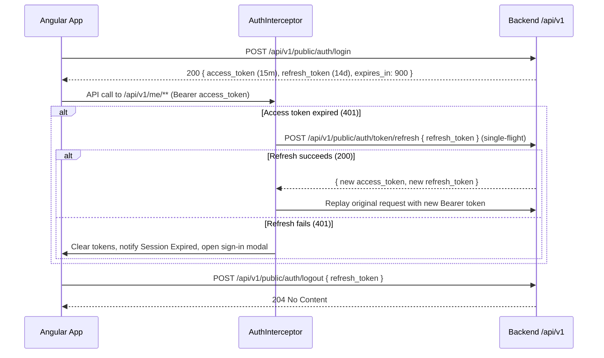

# Discovery — API v1 migration (`api-v1-migration`)

> Track: Feature · Slug: `api-v1-migration` · Authoritative read-only source: `https://github.com/this-is-thiru/wealthlens` (`master` branch). Backend code is never modified.

## 1. Plain-language summary
The WealthLens backend (`master`) has moved to a strict, versioned API (`/api/v1/{public|me|admin}/...`) with three security zones (`public`, signed-in `me`, and `SUPER_USER` `admin`), denying every legacy route by default. At the same time, it introduced:
- **15-minute access tokens + 14-day rotating refresh tokens** (`POST /api/v1/public/auth/token/refresh`, `POST /api/v1/public/auth/logout`).
- **DPDP Act 2023 registration consent:** sign-up requires the live `privacyNoticeVersion` from `GET /api/v1/public/privacy/rights`.
- **No `{ data }` JSON wrapper (`W-359a`):** responses are returned directly (JSON objects/arrays/pages, or raw `text/plain` for `String` endpoints).
- **RFC 9457 `ProblemDetail` errors:** all errors return `{ type, title, status, detail, instance }`, and 500s hide internals behind a request ID.
- **Spring Data `PagedModel` (`via-dto`):** 4 list endpoints now return `{ content: T[], page: { size, number, totalElements, totalPages } }` with `max-page-size: 200`.
- **Strict Jackson & `@Valid` validation:** `fail-on-unknown-properties: true` rejects any unknown request field with HTTP `400`.

Every signed-in user (and `SUPER_USER` admins for admin routes) is affected — currently **all existing UI API calls fail** against backend `master`.

---

## 2. Endpoint inventory & mapping (Old UI → Backend `master`)

> Priority order per Phase 0 approval: **1. Auth & Interceptor → 2. Portfolio/Transactions → 3. Corporate Actions → 4. Broker Charges → 5. Templates**.

### 2.1 Auth & Privacy Notice (Priority 1)
| Method | Path (Backend `master`) | Old UI call | Zone / Role | Return type | Notes |
|---|---|---|---|---|---|
| `GET` | `/api/v1/public/privacy/rights` | *(new)* | Public | JSON `PrivacyNotice` | Provides `version` required for registration |
| `POST` | `/api/v1/public/auth/register` | `POST /auth/register` | Public | **`text/plain`** `String` | Requires `privacyNoticeVersion`; 429 rate-limited |
| `POST` | `/api/v1/public/auth/login` | `POST /auth/login` | Public | JSON `LoginResponse` | Returns 15m `access_token` + 14d `refresh_token`; 429 rate-limited |
| `POST` | `/api/v1/public/auth/token/refresh` | *(new)* | Public | JSON `RefreshResponse` | Rotates refresh token; ignores expired `Authorization` header |
| `POST` | `/api/v1/public/auth/logout` | *(new)* | Public | `204 No Content` | Ends refresh-token session server-side |
| `PUT` | `/api/v1/me/auth/password` | `PUT /auth/user/{email}/change/password` | `me` (JWT) | **`text/plain`** `String` | Email still checked against caller JWT |

### 2.2 Portfolio & Transactions (Priority 2)
| Method | Path (Backend `master`) | Old UI call | Zone / Role | Return type | Notes |
|---|---|---|---|---|---|
| `GET` | `/api/v1/me/portfolio/transactions` | `GET /{email}/all/transactions` | `me` (JWT) | JSON **`PagedModel<TransactionResponse>`** | Paginated (`?page=&size=`, default 50, max 200) |
| `POST` | `/api/v1/me/portfolio/transactions/search` | `POST /transactions/user/{email}` | `me` (JWT) | JSON **`PagedModel<TransactionResponse>`** | Body MUST use `queryFilters` (not `filters`!); paginated |
| `POST` | `/api/v1/me/portfolio/transaction` | `POST /{email}/transaction` | `me` (JWT) | **`text/plain`** `String` | Strict `AssetRequest` validation (`W-365`); `/transaction/v2` also exists |
| `POST` | `/api/v1/me/portfolio/transactions/uploads?quarter=` | `POST /portfolio/user/{email}/upload-transactions` | `me` (JWT) | **`text/plain`** `String` | `quarter` query param is **required**; multipart `file` (max 21 MB) |
| `GET` | `/api/v1/me/portfolio/temporary-transactions` | `GET /temporary-transactions/user/{email}/all` | `me` (JWT) | JSON `TransactionResponse[]` | Unpaged list |
| `POST` | `/api/v1/me/portfolio/temporary-transactions/redrive` | `POST /temporary-transactions/user/{email}/redrive` | `me` (JWT) | JSON `RedriveResult` | No body required |
| `GET` | `/api/v1/me/portfolio/stocks` | `GET /portfolio/user/{email}/stocks/all` | `me` (JWT) | JSON `AssetResponse[]` | Unpaged list |
| `DELETE` | `/api/v1/me/portfolio` | `POST /portfolio/user/{email}/clear/all` | `me` (JWT) | **`text/plain`** `String` | **HTTP method changed `POST` → `DELETE`** |

### 2.3 Corporate Actions (Priority 3)
| Method | Path (Backend `master`) | Old UI call | Zone / Role | Return type | Notes |
|---|---|---|---|---|---|
| `GET` | `/api/v1/me/corporate-actions` (`?ids=`) | `GET /corporate-action/all` & `/list?ids=` | `me` (JWT) | JSON **`PagedModel<CorporateActionResponse>`** | Single endpoint handles both all and `?ids=...`; paginated |
| `GET` | `/api/v1/me/corporate-actions/{id}` | `GET /corporate-action/{id}` | `me` (JWT) | JSON `CorporateActionResponse` | Single item |
| `PUT` | `/api/v1/me/corporate-actions/perform?allBrokers=` | `PUT /corporate-action/user/{email}/perform` | `me` (JWT) | JSON `CorporateActionPerformDto` | Returns JSON echo (old UI used `responseType: 'text'`) |
| `POST` | `/api/v1/admin/corporate-actions` | `POST /corporate-action/add` | `admin` (`SUPER_USER`) | **`text/plain`** `String` | `@Valid CorporateActionDto` |
| `PATCH` | `/api/v1/admin/corporate-actions/{id}` | `PUT /corporate-action/update/priority/{id}/{priority}` | `admin` (`SUPER_USER`) | **`text/plain`** `String` | **Method `PUT` → `PATCH`**, body `{ priority: number }` |
| `PUT` | `/api/v1/admin/corporate-actions/perform` | `PUT /corporate-action/perform` | `admin` (`SUPER_USER`) | **`text/plain`** `String` | Only `NAME_OR_SYMBOL_CHANGE` |
| `DELETE` | `/api/v1/admin/corporate-actions/{id}` | `DELETE /corporate-action/delete/{id}` | `admin` (`SUPER_USER`) | Empty `200` (`void`) | No response text |
| *(retired)* | *(none)* | `PUT /corporate-action/perform/test` | — | — | **Removed from backend** (`anyCorporateActionToPerform`) |

### 2.4 Broker Charges (Priority 4)
| Method | Path (Backend `master`) | Old UI call | Zone / Role | Return type | Notes |
|---|---|---|---|---|---|
| `POST` | `/api/v1/me/charges/simulate` | `POST /charges/simulate` | `me` (JWT) | JSON `ChargeBreakdownResponse` | Requires `transactionDate`, `price` (≥0), `quantity` (>0), and `stockCode` on `BUY`/`SELL` |
| `GET` | `/api/v1/me/charges/charge-catalogue` | `GET /charge-catalogue` | `me` (JWT) | JSON `ChargeCatalogueEntry[]` | Unpaged |
| `GET` | `/api/v1/me/charges/user-charges` | `GET /user-charges/user/{email}` | `me` (JWT) | JSON **`PagedModel<UserChargeResponse>`** | `?from=&to=&assetType=` (both `from` & `to` or neither!); paginated |
| `GET` | `/api/v1/me/charges/user-charges/transaction/{transactionId}` | `GET /user-charges/user/{email}/transaction/{id}` | `me` (JWT) | JSON `ChargeBreakdownResponse` | Contract note |
| `GET` | `/api/v1/me/charges/user-charges/gaps` | `GET /user-charges/user/{email}/gaps` | `me` (JWT) | JSON `UserChargeResponse[]` | Unpaged |
| `GET` | `/api/v1/me/charges/user-charges/reconciliation` | `GET /user-charges/user/{email}/reconciliation` | `me` (JWT) | JSON `ChargeReconciliationResponse` | Unpaged |
| `GET` | `/api/v1/me/charges/charge-accounts` | `GET /charge-accounts/user/{email}` | `me` (JWT) | JSON `ChargeAccountResponse[]` | Unpaged |
| `POST` | `/api/v1/me/charges/charge-accounts` | `POST /charge-accounts/user/{email}` | `me` (JWT) | JSON `ChargeAccountResponse` | Strict `ChargeAccountRequest` — rejects `id`, `email`, `lastBilledThrough`, `billingEvents`! |
| `GET` | `/api/v1/me/charges/charge-schedules?broker=` | `GET /charge-schedules?broker=` | `me` (JWT) | JSON `ChargeScheduleResponse[]` | Unpaged |
| `GET` | `/api/v1/me/charges/charge-schedules/{code}` | `GET /charge-schedules/{code}` | `me` (JWT) | JSON `ChargeScheduleResponse` | Single item |
| `GET` | `/api/v1/me/charges/charge-schedules/unverified` | `GET /charge-schedules/unverified` | `me` (JWT) | JSON `ChargeScheduleResponse[]` | Unpaged |
| `POST` | `/api/v1/admin/charges/charge-schedules` | `POST /charge-schedules` | `admin` (`SUPER_USER`) | JSON `ChargeScheduleResponse` | Strict `ChargeScheduleRequest` — rejects `id` / audit fields |
| `PATCH` | `/api/v1/admin/charges/charge-schedules/{code}/close?endDate=` | `PATCH /charge-schedules/{code}/close?endDate=` | `admin` (`SUPER_USER`) | JSON `ChargeScheduleResponse` | Admin zone |
| `POST` | `/api/v1/admin/charges/seed` | `POST /charges/seed` | `admin` (`SUPER_USER`) | JSON `ChargeSeedReport` | Admin zone |
| `GET` | `/api/v1/admin/charges/charge-schedules/drift` | `GET /charge-schedules/drift` | `admin` (`SUPER_USER`) | JSON `ChargeScheduleDrift[]` | Admin zone |
| `GET` | `/api/v1/admin/charges/charge-accounts/due?frequency=&billedThrough=` | `GET /charge-accounts/due` | `admin` (`SUPER_USER`) | JSON `ChargeAccountResponse[]` | `frequency` must be `ANNUALLY` or `QUARTERLY` |
| `POST` | `/api/v1/admin/charges/amc/impose?frequency=&billedThrough=` | `POST /charges/amc/impose` | `admin` (`SUPER_USER`) | JSON `ChargeAccountResponse[]` | `frequency` must be `ANNUALLY` or `QUARTERLY` |

### 2.5 Templates (Priority 5)
| Method | Path (Backend `master`) | Old UI call | Zone / Role | Return type | Notes |
|---|---|---|---|---|---|
| `GET` | `/api/v1/public/templates` | `GET /helper/template` | Public | Binary `.xlsx` (`Blob`) | Attachment `transactions-template.xlsx` |

---

## 3. Schemas, Enums, Pagination & Error Contracts

### 3.1 Pagination (`PagedModel<T>`, `spring.data.web.pageable.serialization-mode: via-dto`)
- **Query params:** `?page=0&size=200` (`default-page-size: 50`, **`max-page-size: 200`** — anything > 200 is clamped to 200).
- **Response JSON:**
  ```json
  {
    "content": [ /* T[] */ ],
    "page": { "size": 200, "number": 0, "totalElements": 342, "totalPages": 2 }
  }
  ```
- **Frontend strategy (Option A approved):** Implement a reusable pagination helper (`fetchAllPages<T>`) that requests `page=0, size=200` and, if `page.totalPages > 1`, fetches pages `1..totalPages-1` and concatenates `content` (leaving the raw `PagedModel<T>` fetch method available for future server-side pagination UI).

### 3.2 Error Format — RFC 9457 `ProblemDetail` (`ControllerAdviser.java`)
All backend errors return:
```json
{
  "type": "about:blank",
  "title": "Bad Request",
  "status": 400,
  "detail": "Field 'filters' is not one this request accepts",
  "instance": "/api/v1/me/portfolio/transactions/search"
}
```
| Status | When | Key details for UI |
|---|---|---|
| `400` | `@Valid` failure, unknown JSON property, bad enum/date format, missing required param (`quarter`, `privacyNoticeVersion`), taken/held email on register, half-open `from`/`to` date range | Human-readable `detail` naming field/accepted values |
| `401` | Expired/invalid access token, bad credentials (`"Bad credentials"`), invalid/spent refresh token (`"The refresh token is not valid; sign in again"`) | Trigger single-flight refresh on non-auth `401`; logout & redirect to sign-in if refresh fails |
| `403` | Non-`SUPER_USER` calling `/api/v1/admin/**` or legacy unzoned route | Show "Access Denied" using `detail` |
| `404` | Unknown resource / transaction / schedule | Show `detail` |
| `409` | `TradeCollisionException` | Show `detail` |
| `429` | >5 failed sign-ins per email/client or >30 calls to `/api/v1/public/auth/**` in 15 min | Includes `Retry-After` header (seconds); display friendly wait message |
| `500` | Unexpected failure (`W-364`) | `detail`: `"Something went wrong. Quote X-Request-Id <id> when you report it."` |
| `503` | Charges engine disabled (`app.charges.engine-enabled: false`) | Show `detail` |

### 3.3 Key DTO Schemas & Mismatches Found
1. **`LoginResponse`:** `{ access_token: string, expires_in: number (900), refresh_token: string, tokenType: "Bearer", privacy_notice?: string, privacy_notice_version?: string }` — **no `email` field** (extract from JWT `sub`).
2. **`RefreshRequest` / `RefreshResponse`:** `{ refresh_token }` → `{ access_token, expires_in, refresh_token, tokenType }`.
3. **`RegistrationRequest`:** `{ email, password, privacyNoticeVersion }` (register) / `{ email, password, newPassword }` (change password).
4. **`PrivacyNotice` (`GET /api/v1/public/privacy/rights`):** `{ rights, identifier, contact, grievanceResponseDays, purposeLapse, consent, version }` (`PAGE = "/privacy"`).
5. **`BulkGetRequest`:** `{ dateRange?, queryFilters: QueryFilter[] }` — **`{ filters }` is rejected with 400**!
6. **`TransactionResponse`:** uses `transactionId: string` (UUID), `status: 'TEMPORARY' | 'PROCESSED'`, `segment: TradeSegment`, `charges: ChargeNote | null` (no numeric `id`).
7. **`ChargeSimulationRequest`:** requires `brokerName`, `assetType`, `event`, `transactionDate` (`yyyy-MM-dd`), `quantity > 0`, `price >= 0` (non-null), and `stockCode` on `BUY`/`SELL`. *(Current UI model omits `transactionDate` and may omit `stockCode`!)*
8. **`ChargeBreakdownResponse`:** returns `{ scheduleCode, statutoryScheduleCode, instrumentId, resolution, lines, amountByCode, totalCharges }` — **does NOT include `deductibleCharges`, `nonDeductibleCharges`, or `turnover`** (current UI model & template expect them — must be optional or derived client-side!).
9. **`ChargeAccountRequest`:** ONLY accepts `{ accountHolder?, brokerName, dematAccountId, planCode?, openedOn?, amcFrequency, status? }` — sending `id`, `email`, `lastBilledThrough`, or `billingEvents` returns **400**!
10. **`ChargeScheduleRequest`:** ONLY accepts `{ scheduleCode, brokerName, assetType, segment, exchange, planCode, startDate, endDate, status, requiresInstrumentProfile, rules, sourceUrl, verifiedOn }` — sending `id` or audit fields returns **400**!

### 3.4 Authoritative Backend Enums
| Enum | Values | Current UI Mismatch? |
|---|---|---|
| `BrokerName` | `UPSTOX`, `FYERS`, `ZERODHA` | Check UI dropdowns (must be uppercase) |
| `AssetType` | `EQUITY`, `MUTUAL_FUND`, `BOND`, `GOLD_BOND`, `FD`, `INSURANCE`, `LAND_OR_BUILDING` *(refused on trade paths)* | Check UI dropdowns |
| `TradeSegment` | `DELIVERY`, `INTRADAY`, `FUTURES`, `OPTIONS`, `NA` | Matches |
| `TransactionType` | `BUY`, `SELL` | Matches |
| `CorporateActionType` | `DIVIDEND`, `BONUS`, `STOCK_SPLIT`, `BUYBACK`, `RIGHTS_ISSUANCE`, `DEMERGER`, `NAME_OR_SYMBOL_CHANGE` | Matches |
| **`AmcChargeFrequency`** | **`ANNUALLY`, `QUARTERLY`** | **BREAKING:** UI uses **`YEARLY`** → must change to **`ANNUALLY`**! |
| `ChargeEvent` | `BUY`, `SELL`, `ACCOUNT_OPENING`, `AMC_CYCLE`, `CALL_AND_TRADE`, `AUTO_SQUARE_OFF`, `PLEDGE` | Matches |
| `AccountType` | `SELF`, `OUTSOURCED` | Matches |
| Accepted `exchangeName` per `AssetType` | `EQUITY`/`MUTUAL_FUND`: `[NSE, BSE]`; `BOND`/`GOLD_BOND`: `[NSE, BSE, OFF_EXCHANGE]`; `FD`/`INSURANCE`: `[OFF_EXCHANGE]` | Strict 400 validation (`W-353`) |

---

## 4. Auth & Token Rotation Flow



---

## 5. Breaking Changes, Compatibility & Security Notes

| # | Category | Finding |
|---|---|---|
| 1 | **Breaking — Routes** | All 30+ existing UI API paths are denied on backend `master`; every service must move to `/api/v1/{public\|me\|admin}/...` and drop `{email}` from `/me` URLs. |
| 2 | **Breaking — No `{ data }` wrapper & `text/plain`** | Removing the legacy `{ data }` unwrapper in `AuthInterceptor` is mandatory; all `String`-returning endpoints (`register`, `changePassword`, `addTransaction`, `uploadTransactions`, `clearAllRecords`) MUST pass `responseType: 'text'` or Angular's `HttpClient` throws a JSON parse error on HTTP 200! |
| 3 | **Breaking — Pagination** | 4 endpoints return `PagedModel<T>` instead of `T[]`; must unwrap via reusable pagination helper (`size=200`, max-page-size cap). |
| 4 | **Breaking — Strict DTOs (`fail-on-unknown-properties: true`)** | `{ filters }` → `{ queryFilters }`; `ChargeAccountRequest` & `ChargeScheduleRequest` must strip server-owned fields; `AmcChargeFrequency` `YEARLY` → `ANNUALLY`; `ChargeSimulationRequest` requires `transactionDate`, `price`, and `stockCode` on `BUY`/`SELL`; upload requires `quarter`. |
| 5 | **Breaking — Response shape** | `ChargeBreakdownResponse` no longer returns `deductibleCharges`, `nonDeductibleCharges`, or `turnover` — UI must derive or guard them; `PUT /corporate-action/perform/test` was removed. |
| 6 | **Security — Refresh token storage** | Backend returns `refresh_token` in JSON body (not an `HttpOnly` cookie), so the SPA must store it in browser storage (`localStorage` / `sessionStorage`). This carries XSS exposure risk — keep tokens out of URLs/console logs, clear both tokens on logout/refresh failure, and use single-flight refresh to avoid token-reuse revocation races. |
| 7 | **Security — Public auth endpoints & `Authorization`** | Even though backend ignores `Authorization` on `/api/v1/public/**`, `AuthInterceptor` should not attach expired tokens to `/api/v1/public/**` and must not trigger 401 refresh/redirect loops on `/api/v1/public/auth/**`. |
| 8 | **Security — Admin routes** | Admin endpoints now live under `/api/v1/admin/**` and require `SUPER_USER` (not `ADMIN`). `AuthService.isAdmin()` currently treats both `ADMIN` and `SUPER_USER` as admin — UI admin controls for `/api/v1/admin/**` should align with `SUPER_USER` (`isSuperUser`) or handle `403` cleanly. |

---

## 6. Gaps & Questions for Backend Developer / Thiru

| # | Question | Status |
|---|---|---|
| 1 | `❓ OPEN QUESTION` **Transaction V1 vs V2:** Backend exposes both `POST /api/v1/me/portfolio/transaction` (V1) and `/transaction/v2` (V2, where authoritative broker charges run). Should `TransactionService.addTransaction()` target `/transaction/v2` or keep `/transaction`? | OPEN |
| 2 | `❓ OPEN QUESTION` **Retired `PUT /corporate-action/perform/test`:** No longer exists in `corporate.md` or controllers. Confirm we can remove `anyCorporateActionToPerform()` if unused in components (will verify usage in Phase 2). | OPEN |
| 3 | `❓ OPEN QUESTION` **`ChargeBreakdownResponse` missing `deductibleCharges`, `nonDeductibleCharges`, `turnover`:** Should UI compute `turnover = quantity * price` (for simulations) and derive `deductibleCharges`/`nonDeductibleCharges` from `lines` + catalogue (`STT` non-deductible) when backend omits them? | OPEN |
| 4 | `❓ OPEN QUESTION` **`refresh_token` storage:** Store `refresh_token` in `localStorage` (persists across tabs/restarts like `JWT_TOKEN` today) or `sessionStorage` (cleared when tab closes)? | OPEN |
| 5 | `❓ OPEN QUESTION` **Upload `quarter` param:** Backend `@RequestParam("quarter")` is required on `POST /api/v1/me/portfolio/transactions/uploads`. Confirm the exact string format backend expects (e.g. `Q1`, `Q2`, `Q3`, `Q4`, or `2025-Q1`) and whether the upload UI already collects it. | OPEN |

---

## Changelog
| Version | Date | Change |
|---|---|---|
| 1.0 | 2026-11-25 | Initial Phase 1 Discovery audit against `this-is-thiru/wealthlens` `master` |
