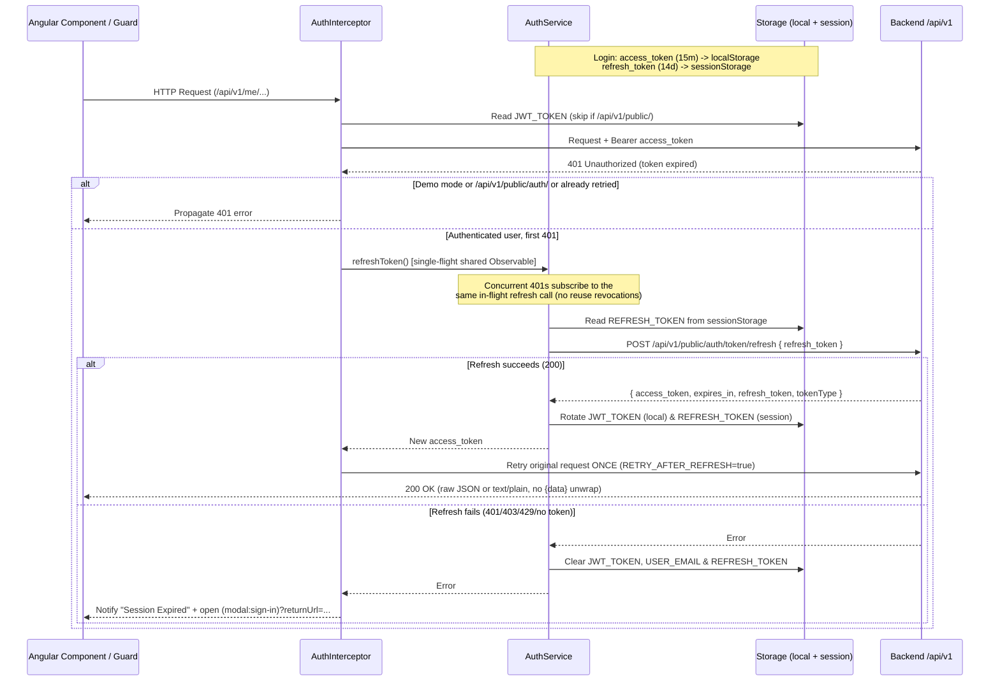
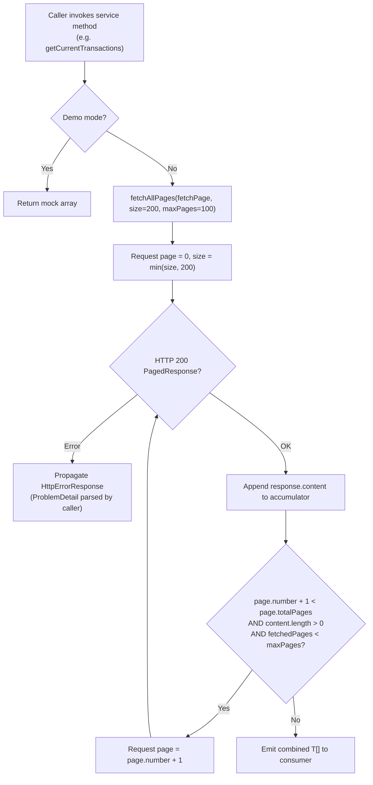
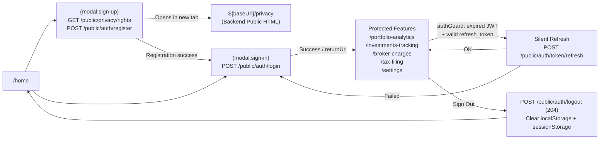

# Design — API v1 migration (`api-v1-migration`)

> Track: Feature · Slug: `api-v1-migration` · Design system reference: [design-system.md](file:///c:/Users/raja1/Documents/Coding/Angular/wealthlens-fe/docs/design-system.md) · Backend `master` is read-only.

---

## 1. Design System Alignment

All UI additions strictly reuse existing tokens and primitives from [design-system.md](file:///c:/Users/raja1/Documents/Coding/Angular/wealthlens-fe/docs/design-system.md) and `WealthLensPreset`:
- **Surfaces & Borders:** `bg-surface`, `bg-surface-alt`, `border-border`, `border-divider`, `rounded-lg`, `rounded-xl`.
- **Typography & Text:** Manrope (`15px` base), `text-white`, `text-text-secondary`, `text-text-muted`, `text-xs`, `text-2xs`, `font-mono` for currency/codes.
- **Accents & Status:** `text-accent`, `hover:text-accent-hover`, `text-success`, `text-danger`, `text-warning`, `bg-surface-input`.
- **Shared UI Primitives:** `ui-modal`, `ui-input`, `ui-button`, `ui-alert`, `ui-badge`, `app-expansion-panel`, `NotificationService`.
- **Constraints:** No new colors, no new fonts, no new UI libraries, no restyling of existing components, no unrelated layout changes.

---

## 2. Screen Wireframes (Layout & Flow Only)

### 2.1 Sign-Up Modal — DPDP Privacy Notice Consent
- **Component:** `SignUpComponent` (`src/app/features/auth/components/sign-up/sign-up.component.html`)
- **Modelled on:** Existing `SignInComponent` / `SignUpComponent` modal layout (`ui-modal size="sm"`).
- **Verified Backend Contract:**
  - `GET /api/v1/public/privacy/rights` → `PrivacyNotice` (`version`, `contact`, `rights`, `consent`, `grievanceResponseDays`, `purposeLapse`).
  - Public HTML page: `${baseUrl}/privacy` (verified in `PrivacyNotice.PAGE = "/privacy"` & `PrivacyNoticeIntegrationTest.java`).

```text
+----------------------------------------------------+
|  Create your account                          [x]  |
|  Sign up to start tracking your investments        |
|                                                    |
|  Email                                             |
|  [ Enter your email                            ]   |
|                                                    |
|  Password                                          |
|  [ Create a password                      (eye)]   |
|                                                    |
|  Confirm Password                                  |
|  [ Re-enter Password                      (eye)]   |
|                                                    |
|  +--[1] DPDP Consent Box (bg-surface-alt)-------+  |
|  | [ ] I have read and agree to the             |  |
|  |     [Privacy Notice ↗] (v2026-01)       [2]  |  |
|  |     and consent to processing my data.       |  |
|  +----------------------------------------------+  |
|  (If loading: subtle spinner "Loading privacy      |
|   notice..." · If failed: [3] ui-alert danger      |
|   + [Retry] button)                                |
|                                                    |
|  [4][               Sign up                    ]   |
|                                                    |
|         Already have an account? Sign in           |
+----------------------------------------------------+
```

**Callouts:**
1. **Consent container (`bg-surface-alt border border-border rounded-lg p-3`):** Native accessible `<input type="checkbox" id="register-privacy-consent" formControlName="acceptPrivacyNotice">` paired with `<label for="register-privacy-consent">`. **Never preselected** (initial value `false`, `Validators.requiredTrue`).
2. **Privacy Notice link & version:** `<a [href]="privacyNoticeUrl" target="_blank" rel="noopener noreferrer" class="text-accent hover:text-accent-hover underline">` pointing to `${baseUrl}/privacy`, with the fetched `privacyNoticeVersion` displayed cleanly in `text-2xs text-text-muted font-mono`.
3. **Failure safeguard (`ui-alert tone="danger"`):** If `GET /api/v1/public/privacy/rights` fails, show a compact inline alert ("Could not load the Privacy Notice. Registration is temporarily unavailable.") with a `ui-button` (`variant="secondary" size="sm"`) **Retry** action.
4. **Submit button (`ui-button variant="primary" [fullWidth]="true"`):** Disabled whenever `registrationForm.invalid || !privacyNoticeVersion || isLoadingPrivacyNotice || isLoading`. Submitting sends the exact fetched `privacyNoticeVersion` in `RegisterRequest`. Rate-limit `429` errors display `ProblemDetail.detail` / `Retry-After` guidance via `NotificationService`.

---

### 2.2 Broker Charges — Pre-Trade Simulator & Contract Note
- **Component:** `BrokerChargesComponent` (`src/app/features/broker-charges/pages/broker-charges/broker-charges.component.html`)
- **Modelled on:** Existing `BrokerChargesComponent` 12-column simulator grid (`lg:col-span-5` inputs + `lg:col-span-7` breakdown).

```text
+-------------------------+--------------------------------------------------+
| Order Inputs            | [Turnover] [Charges & Taxes] [Net] [Break-Even]  |
|                         |                                                  |
| Trade Action            | +--[2] Deductibility Summary Banner-----------+  |
| [ BUY ]  [ SELL ]       | | ● Deductible: ₹XX.XX   ● Non-Deductible: ₹Y  |  |
|                         | |   (or "—" if charge catalogue unavailable)   |  |
| Broker     | Asset      | +----------------------------------------------+  |
| [Zerodha]  | [Equity]   |                                                  |
|                         | Itemized Contract Note Lines   Schedule: ZER-... |
| Segment    | Exchange   | +----------------------------------------------+ |
| [Delivery] | [NSE]      | | Component | Category | Taxable Base | Amount | |
|                         | | Brokerage | BROKER.. | Yes (GST)    |  ₹0.00 | |
| [1] Symbol | Trade Date | | STT       | STATUT.. | Exempt       | ₹150.0 | |
| [RELIANCE] | [2026-11..]| +----------------------------------------------+ |
|                         |                                                  |
| Quantity   | Price (₹)  | [3] Error Toast (real users only):               |
| [ 100 ]    | [ 1500 ]   | Shows ProblemDetail.detail when API fails        |
|                         | (Demo mode retains offline mock fallback)        |
| [ Recalculate Friction] |                                                  |
+-------------------------+--------------------------------------------------+
```

**Callouts:**
1. **Symbol & Transaction Date (`grid-cols-2 gap-3`):** Pairs existing `Symbol / Scrip` (required for `BUY`/`SELL`, inline hint if blank) with the new required `Transaction Date` (`<input type="date" id="sim-transaction-date">`, formatted `yyyy-MM-dd`, defaults to today) using the exact existing input classes (`w-full bg-surface border border-border rounded-lg px-2.5 py-1.5 text-xs text-white focus:outline-none focus:border-accent font-mono`).
2. **Catalogue-backed Deductibility Banner (Simulator, Contract Note Modal & Ledger Summary):**
   - Computes `deductibleCharges` and `nonDeductibleCharges` **only** when `catalogueEntries()` is loaded and every `line.code` maps to a known `deductibleForCapitalGains` boolean.
   - When unmapped or catalogue is unavailable, renders `—` (`text-text-muted`) with a title/hint `"Classification unavailable"` — **never** displays guessed figures.
3. **Real-User Error Surfacing (A1):** When `authService.isDemo()` is `false`, failed API requests surface `ProblemDetail.detail` via `NotificationService` / toast and do **not** fall back to mock numbers.
4. **AMC Frequency Selectors (Demat Account Modal & Admin AMC Console):** Option value updated from `YEARLY` → `ANNUALLY` (display labels `Annual` / `Annual AMC`). No layout change.

---

## 3. Flow Diagrams (Mermaid)

### 3.1 Authentication, Single-Flight Refresh Rotation & Error Handling


### 3.2 Reusable Pagination-Aware Fetching (`fetchAllPages`, Option A)


### 3.3 Screen & Modal Navigation Flow


---

## 4. Accessibility & Responsiveness Checklist
- Every new input (`#register-privacy-consent`, `#sim-transaction-date`) has an explicit `<label for="...">`, keyboard focus ring (`focus:border-accent`), and descriptive error feedback.
- External privacy link uses `target="_blank" rel="noopener noreferrer"` and readable contrast (`text-accent` on `bg-surface-alt`).
- Simulator's `Symbol` + `Transaction Date` row uses `grid-cols-1 sm:grid-cols-2 gap-3` so narrow mobile viewports stack cleanly without overflow.
- Deductibility banner uses `flex-col sm:flex-row` (existing pattern) and never relies solely on color to communicate unavailable (`—`) state.

---

## Changelog
| Version | Date | Change |
|---|---|---|
| 1.0 | 2026-11-25 | Created in Phase 3 — Design: audited `docs/design-system.md`, verified backend `/privacy` HTML route, drafted Sign-Up DPDP consent & Broker Charges simulator wireframes and Mermaid flows |
