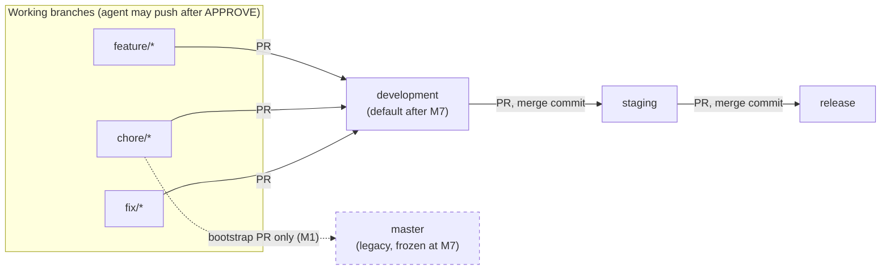
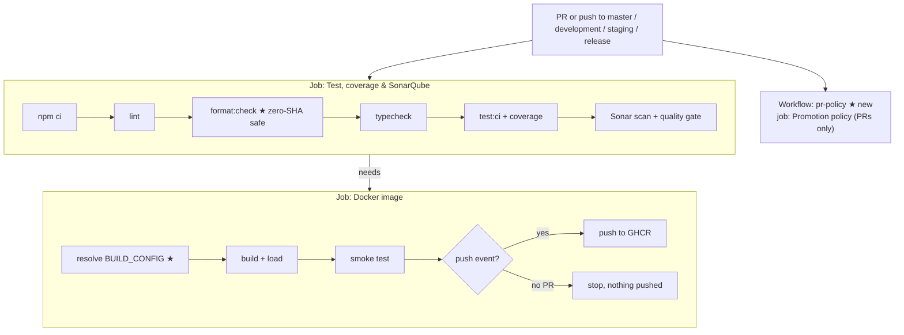
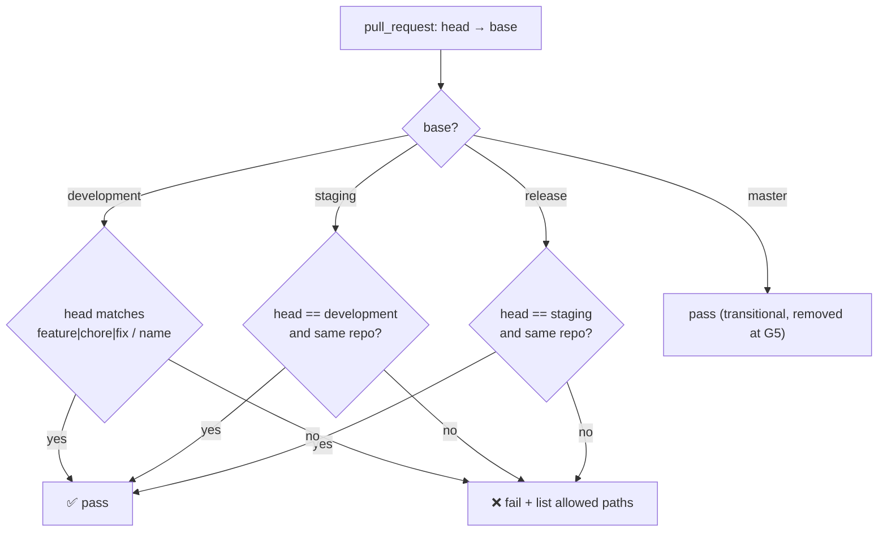
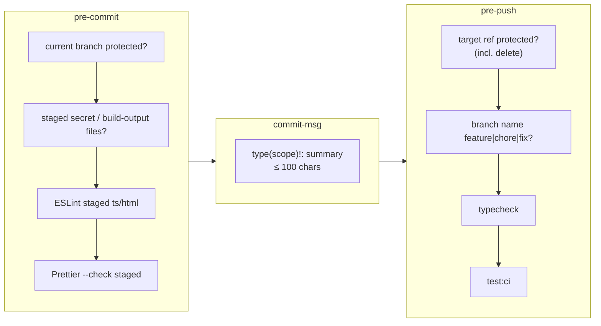
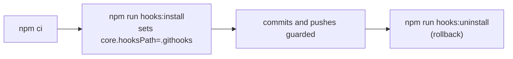
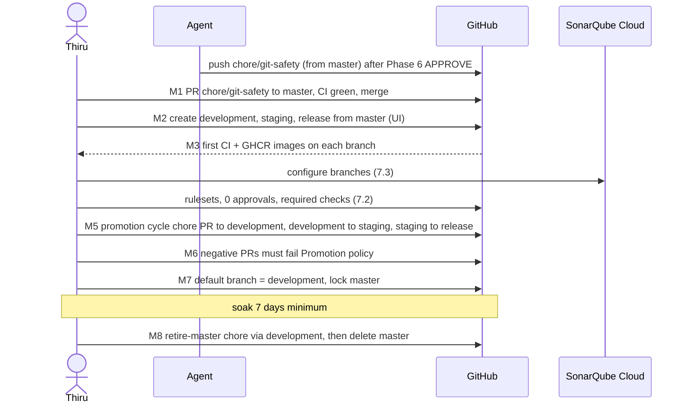
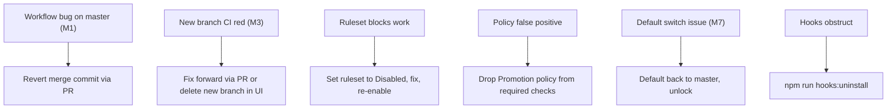

# Design — Git safety & branch environments

> Track: Chore · Slug: `git-safety` · Diagrams and tables only. Applies approved Phase 2 plan and decisions A–G. Nothing is implemented yet.
> Design-system note: `docs/design-system.md` was created this phase (first Phase 3) as the lifecycle requires. This chore has no UI, so none of its tokens apply here.

## 1. Decisions locked in

| Ref | Decision | Design consequence |
|---|---|---|
| A | `chore/git-safety` from `master`; `master` never modified or deleted by the agent | Bootstrap PR targets `master` (only possible base today). Every later change follows the promotion flow |
| B | Staging/production API URLs are a separate chore | `environment.*.ts` untouched; no new URLs or endpoints invented |
| C | Delete `master` only after ≥ 1 full successful promotion cycle **and** ≥ 7 days soak | Both conditions are gate G5 in §7 |
| D | 0 required approvals; all required checks and protections stay on | Rulesets keep PR-required, status checks, no force-push, no deletion |
| E | All hook extras kept | Guards shown in §5 |
| F | `pre-push` uses `npm run test:ci` | See §5.3 verification |
| G | No `hotfix/*` → `release` | Policy table in §4 has no hotfix row |

## 2. Branch flow

| Rule | Detail |
|---|---|
| Agent pushes | Only `feature/*`, `chore/*`, `fix/*` |
| Promotion PRs | Created and merged by Thiru; merge-commit only into `staging` and `release` |
| `master` | Untouched until gate G5; then removed by Thiru |

## 3. Pipeline steps per branch (existing `ci-cd.yml`, with the planned changes marked ★)

| Branch | Event | Docker `BUILD_CONFIG` | Pushed to GHCR |
|---|---|---|---|
| `master` (transitional) | PR / push | `development` | push only |
| `development` | PR / push | `development` | push only |
| `staging` | PR / push | **`staging`** ★ (was `development`) | push only |
| `release` | PR / push | `production` | push only |

## 4. Promotion policy (new CI check `Promotion policy`)

| PR | Result |
|---|---|
| `chore/foo → development` | ✅ |
| `development → staging` | ✅ |
| `staging → release` | ✅ |
| `feature/x → staging`, `chore/x → release` | ❌ |
| `development → release` | ❌ |
| `hotfix/x → release` (decision G) | ❌ |
| fork branch named `development → staging` | ❌ (different head repo) |
| `anything → master` | ✅ until `master` is retired |

Inputs reach the script through environment variables only (no shell interpolation of branch names). The job name `Promotion policy` is fixed so rulesets can require it.

## 5. Local hooks

### 5.1 Flow

### 5.2 Guard matrix

| Guard | pre-commit | commit-msg | pre-push |
|---|:---:|:---:|:---:|
| Protected branches `development`, `staging`, `release`, `master` | ✅ | | ✅ |
| Branch-name pattern | | | ✅ |
| Secret/build files (`.env*` except `.env.example`, `*.pem`, `*.key`, `node_modules/`, `dist/`, `coverage/`) | ✅ | | |
| ESLint (staged) | ✅ | | |
| Prettier check (staged) | ✅ | | |
| Conventional Commits | | ✅ | |
| Typecheck | | | ✅ |
| Unit tests with coverage thresholds | | | ✅ |

No hook rewrites files. Bypass flags are not offered (no `--no-verify` guidance, no env override).

### 5.3 Decision F verified against `package.json` / `angular.json`
| Check | Finding |
|---|---|
| `test:ci` = `ng test --configuration=ci` | Exists |
| Non-interactive | `ci` configuration sets `watch: false` (no prompts) |
| Reliable / deterministic | Vitest on happy-dom, no browser; same command CI runs |
| Duplication | `pre-push` runs only typecheck + `test:ci`; lint and format run only in `pre-commit`; no check repeated locally (CI repeats them by design as the authoritative gate) |
| Side effects | Writes `coverage/` (gitignored, excluded from Docker context and Sonar) |
| Trade-off | Slower than `npm test` because of coverage; accepted per your decision. Measured run time recorded in §10 |

### 5.4 Install lifecycle

No `prepare`/`postinstall` auto-install (CI and Docker use `--ignore-scripts`).

## 6. Docker tags per environment (unchanged scheme)

| Branch | Build config | Tags pushed (`ghcr.io/this-is-thiru/wealthlens-fe`) | Output hashing |
|---|---|---|---|
| `development` | `development` | `development`, `development-<sha>` | none |
| `staging` | `staging` | `staging`, `staging-<sha>` | **all** ★ |
| `release` | `production` | `release`, `release-<sha>`, **`latest`** | all |
| `master` (transitional) | `development` | `master`, `master-<sha>` | none |

`latest` is produced by `release` pushes only. API URLs inside images remain the current `environment.*.ts` values (decision B).

## 7. Migration timeline and gates

| Gate | Condition to pass | Blocks |
|---|---|---|
| G1 | Bootstrap PR CI green on `master` | M2 |
| G2 | First CI run on each new branch green; images and tags present (§6) | rulesets |
| G3 | Required check names visible in ruleset picker | M5 |
| G4 | Positive promotion cycle merged **and** negative PRs rejected | M7 |
| G5 | G4 + ≥ 7 days since M7 + no CI/promotion incident | deleting `master` |

## 8. Rollback map

`master` stays intact until G5, so every path has a working fallback.

## 9. Manual configuration index (details in plan §7; copied into `docs/branching-strategy.md` in WI-4.1)

| Area | Checklist | Owner |
|---|---|---|
| GitHub repo settings and rulesets (0 approvals, required checks: `Test, coverage & SonarQube`, `Docker image`, `Promotion policy`; merge commits only on `staging`/`release`; no force-push/deletion) | plan §7.1–7.2 | Thiru |
| SonarQube Cloud (main branch, long-lived pattern, new code, gate, automatic analysis off) | plan §7.3 | Thiru |
| GHCR (Actions write access, visibility, tag check, retention) | plan §7.4 | Thiru |
| Developer machines (`npm run hooks:install`) | plan §7.5 | Each dev |
| Retire `master` (after G5) | plan §7.6 | Thiru |

## 10. Verification note (decision F)
`npm run test:ci` was run on this machine on 2026-11-23 to confirm it is non-interactive and passes: exit code 0 in about 69 s, no prompts, coverage above the 20% thresholds. Expect `pre-push` to take roughly 1.5 min including typecheck.

## Changelog
| Version | Date | Change |
|---|---|---|
| 1.0 | 2026-11-23 | Initial Phase 3 design |
