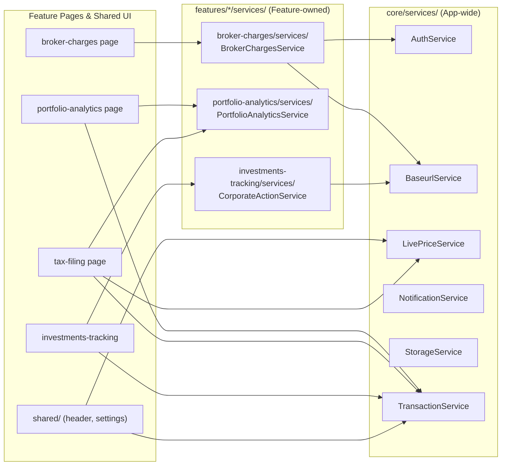

# Design — Service folder structure refactor

> Track: Chore · Slug: `service-structure` · Diagrams and tables only. `docs/design-system.md` already exists; this chore makes zero UI or behaviour changes. Nothing is implemented yet.

## 1. Before vs After folder structure

### Before (current)
```text
src/app/
  core/services/
    auth.service.ts
    baseurl.service.ts
    broker-charges.service.ts            <-- feature-owned (move)
    live-price.service.ts
    notification.service.ts
    portfolio-analytics.service.ts       <-- feature-owned (move)
    portfolio-analytics.service.spec.ts  <-- feature-owned (move)
    storage.service.ts
    transaction.service.ts
    transaction.service.spec.ts
  features/
    broker-charges/
      models/
      pages/
    investments-tracking/
      services/corporate-action.service.ts
    portfolio-analytics/
      pages/
  shared/ui/confirm-dialog/
    confirm-dialog.service.ts
    confirm-dialog.service.spec.ts
```

### After (target)
```text
src/app/
  core/services/                         # App-wide & multi-feature services only (6)
    auth.service.ts
    baseurl.service.ts
    live-price.service.ts
    notification.service.ts
    storage.service.ts
    transaction.service.ts
    transaction.service.spec.ts
  features/
    broker-charges/
      models/
      pages/
      services/
        broker-charges.service.ts        # Moved via git mv
    investments-tracking/
      services/
        corporate-action.service.ts      # Already colocated
    portfolio-analytics/
      pages/
      services/
        portfolio-analytics.service.ts       # Moved via git mv
        portfolio-analytics.service.spec.ts  # Moved via git mv
  shared/ui/confirm-dialog/
    confirm-dialog.service.ts            # Already colocated
    confirm-dialog.service.spec.ts
```

---

## 2. Service dependency diagram (app-wide vs feature-owned)



- **Zero circular dependencies:** `broker-charges` and `portfolio-analytics` services only depend downward on `core/services/` and `@models/*`; no core or shared module imports from any `features/*/services/`.

---

## 3. Exact import & ESLint suppression mapping

### 3.1 Import updates (4 files)
| File | Old import | New import |
|---|---|---|
| `src/app/features/broker-charges/services/broker-charges.service.ts` | `../../features/broker-charges/models/broker-charges.model` | `../models/broker-charges.model` |
| `src/app/features/broker-charges/pages/broker-charges/broker-charges.component.ts` | `@core/services/broker-charges.service` | `@features/broker-charges/services/broker-charges.service` |
| `src/app/features/portfolio-analytics/pages/portfolio-analytics/portfolio-analytics.component.ts` | `@core/services/portfolio-analytics.service` | `@features/portfolio-analytics/services/portfolio-analytics.service` |
| `src/app/features/tax-filing/pages/tax-filing/tax-filing.component.ts` | `@core/services/portfolio-analytics.service` | `@features/portfolio-analytics/services/portfolio-analytics.service` |

### 3.2 `eslint-suppressions.json` path-key updates (counts preserved identically)
| Old key | New key | Preserved rule counts |
|---|---|---|
| `src/app/core/services/broker-charges.service.ts` | `src/app/features/broker-charges/services/broker-charges.service.ts` | `@typescript-eslint/no-unused-vars: 3` |
| `src/app/core/services/portfolio-analytics.service.spec.ts` | `src/app/features/portfolio-analytics/services/portfolio-analytics.service.spec.ts` | `@typescript-eslint/array-type: 2`, `@typescript-eslint/no-explicit-any: 3` |
| `src/app/core/services/portfolio-analytics.service.ts` | `src/app/features/portfolio-analytics/services/portfolio-analytics.service.ts` | `@typescript-eslint/array-type: 1` |

---

## 4. Verification boundary (Docker-free local workflow)
- **Local (Node.js / npm / Angular CLI / Git only):** `npm run lint`, `npm run format:check`, `npm run typecheck`, stale-import grep, `npm run test:ci`, and `ng build` (`development` + `production`).
- **Cloud (GitHub Actions on PR `chore/service-structure → development`):** `Promotion policy`, `Test, coverage & SonarQube`, and mandatory `Docker image` build + `Smoke test image`.

---

## Changelog
| Version | Date | Change |
|---|---|---|
| 1.0 | 2026-11-24 | Initial Phase 3 design: before/after trees, dependency diagram, import and ESLint suppression tables |
